  
  
  
  
  

I'm a software engineer in Hamburg, building AI agents: a [coding agent in Go](https://github.com/ChamsBouzaiene/dodo) and a [browser agent you text from Telegram](https://github.com/ChamsBouzaiene/CtxAnt). Lately I've been pointing agents at real codebases to find real vulnerabilities.

I like agents that do actual work: tight tool loops, sandboxed execution, honest measurement, and results anyone can reproduce. I post what I learn on X at **[@ChamsTech](https://x.com/ChamsTech)**.

## What I'm building

<table>
<tr>
<td width="50%" valign="top">

### [dodo](https://github.com/ChamsBouzaiene/dodo)

Open-source AI coding agent written in Go. Commands run in a Docker sandbox, it works with any LLM provider, and there's no LangChain or agent framework underneath, just its own engine.

 `Go` `React Ink` `Docker`

</td>
<td width="50%" valign="top">

### [CtxAnt](https://github.com/ChamsBouzaiene/CtxAnt)

Text any agent on Telegram and it drives the Chrome you're already signed into. Use 12 starter agents or build your own in 30 seconds. Everything runs on your Mac. [ctxant.com →](https://ctxant.com)

 `Python` `macOS` `Chrome extension`

</td>
</tr>
<tr>
<td width="50%" valign="top">

### [Rediscovering CVE-2026-42945](https://github.com/ChamsBouzaiene/ai-vuln-rediscovery-nginx-cve-2026-42945)

An LLM audit of nginx's rewrite module rediscovers a heap buffer overflow, confirmed with an AddressSanitizer PoC. Prompts, PoC and methodology are all included, along with an honest note on what the AI did and didn't do.

`C` `ASan` `LLM auditing`

</td>
<td width="50%" valign="top">

### In the lab 🔒

Private for now, public when they're ready:

- a measured agent fleet for vulnerability discovery, with a ledger for every stage
- a local code-intelligence CLI with hybrid semantic search

`Go` `Python` `TypeScript`

</td>
</tr>
</table>

## Toolbox

Agent loops · tool calling · MCP · browser automation · sandboxed execution · LLM-assisted code auditing

<b>Earlier work</b>: web, blockchain and tooling from before the agent era

 

| Project | What it is |
| --- | --- |
| [react-component-lib-boilerplate](https://github.com/ChamsBouzaiene/react-component-lib-boilerplate) | Starter kit for shipping a React component library |
| [Poa-Blockchain-Docker-Compose-env](https://github.com/ChamsBouzaiene/Poa-Blockchain-Docker-Compose-env) | Spin up a proof-of-authority Ethereum network with Docker Compose |
| [ethereum-bridge](https://github.com/ChamsBouzaiene/ethereum-bridge) | Link private and public chains through events and a message queue |
| [SVG-Editor](https://github.com/ChamsBouzaiene/SVG-Editor) | SVG editor in vanilla JavaScript |
| [D3Export](https://github.com/ChamsBouzaiene/D3Export) | Export D3 charts and SVGs to PDF and images |
| [san-kou7.JS](https://github.com/ChamsBouzaiene/san-kou7.JS) | A platformer game made in Tunisia, in pure vanilla JS |
| [QA-agent](https://github.com/ChamsBouzaiene/QA-agent) | AI agent that suggests QA steps for developers |
| [AIinfluencerNet](https://github.com/ChamsBouzaiene/AIinfluencerNet) | Platform for running a network of AI influencers |

 

  Building agents too? My DMs on <a href="https://x.com/ChamsTech">X</a> are open.

